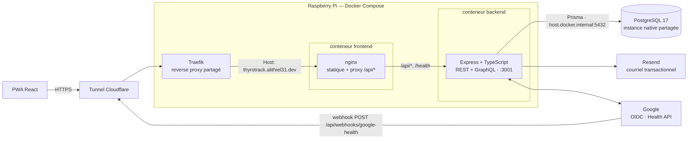
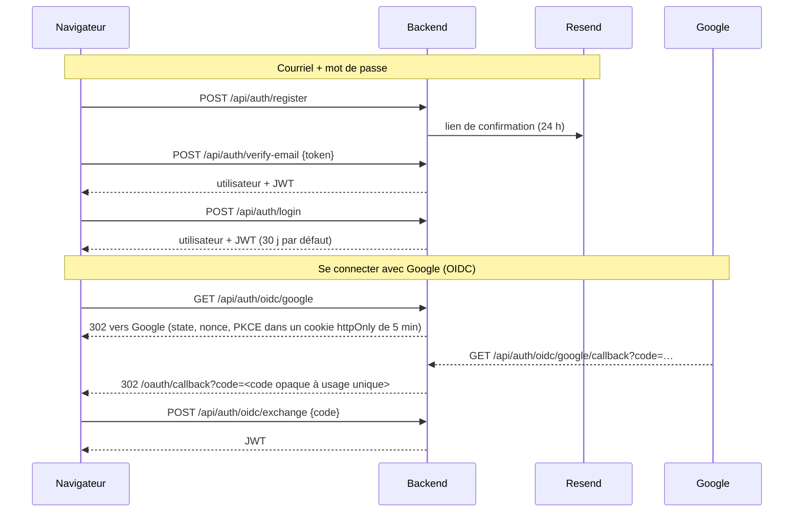
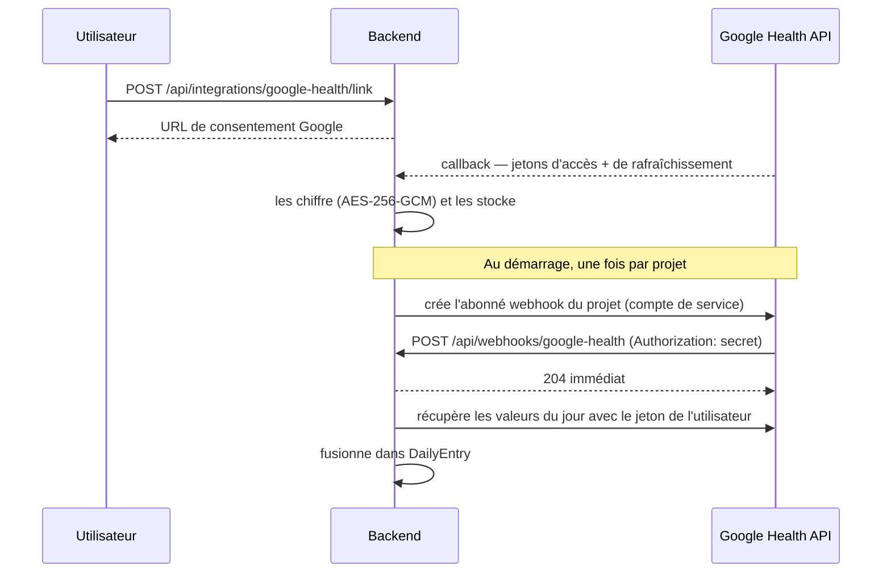
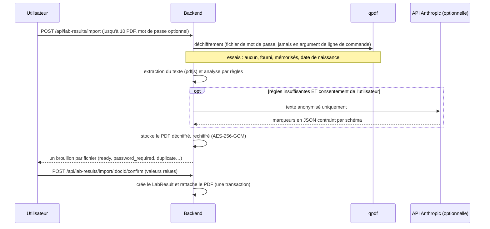

# Architecture

🇬🇧 [English version](./architecture.md)

[Retour au README](../README.fr.md)

Vue d'ensemble du système, du navigateur jusqu'à la base de données et aux services externes :



Le navigateur ne parle jamais qu'à nginx. nginx sert le build React et proxifie `/api/*` (et
`/health`) vers le backend Express sur le réseau Docker interne — en same-origin, donc sans CORS en
production. Le backend est le seul composant qui parle à PostgreSQL (via Prisma), à Resend et à
Google. Aucun port d'hôte n'est publié : `frontend` rejoint le réseau `traefik-net` (créé par le
Traefik partagé, déclaré `external: true`) et porte les labels `traefik.*` qui routent
`thyrotrack.alithiel31.dev` vers son port `80`.

PostgreSQL n'est **pas** un service du `docker-compose.yml`. C'est une instance native partagée avec
d'autres projets de l'hôte, jointe depuis le conteneur backend via `host.docker.internal` (l'entrée
`extra_hosts` la fait pointer vers la passerelle de l'hôte). Le rôle applicatif `thyrotrack_app` et
la base `thyrotrack` doivent donc exister avant le premier démarrage.

---

## Authentification



- **JWT** — `Authorization: Bearer <token>`, signé avec `JWT_SECRET` (en production, le serveur refuse
  de démarrer sous 32 caractères). Le frontend le garde dans `localStorage` (`thyro_token`) et un
  intercepteur axios l'attache ; tout `401` l'efface et redirige vers `/login`.
- **Mots de passe** — bcrypt (coût 12), 8 caractères minimum. Un compte créé via Google n'a pas de mot
  de passe local tant que l'utilisateur n'en définit pas un (`User.password` est nullable). Un compte
  ne peut pas se connecter avant d'avoir vérifié son courriel.
- **OIDC** — géré avec `openid-client` (code d'autorisation + PKCE). Le JWT n'apparaît jamais dans une
  URL : le callback redirige avec un code opaque de courte durée que la SPA échange. La liaison et la
  déliaison de Google sur un compte existant sont `POST`/`DELETE /api/auth/oidc/google/link`,
  protégées par le JWT.
- **Traçabilité** — connexions, liaisons, conflits et échecs sont écrits dans `auth_events`
  (`AuthEventType`, avec IP et user agent) et exposés à l'utilisateur par `GET /api/profile/security/events`.
- **Rôles** — `USER` ou `ADMIN`. `requireAdmin` relit le rôle en base à chaque requête au lieu de se
  fier au token : un rôle révoqué prend effet immédiatement. Les administrateurs gèrent le contenu
  éditorial (`/admin/articles`).

---

## Synchronisation Google Health

Fonctionnalité distincte de « Se connecter avec Google » : elle pré-remplit **poids, fréquence
cardiaque et heures de sommeil** dans le journal quotidien depuis un appareil connecté (par exemple
une Pixel Watch). Deux identifiants distincts interviennent :



- **OAuth utilisateur** (`GOOGLE_HEALTH_CLIENT_ID`/`SECRET`) — chaque utilisateur consent une fois. Les
  jetons sont stockés **chiffrés** dans `google_health_connections` (`lib/crypto.ts`, AES-256-GCM avec
  `TOKEN_ENCRYPTION_KEY` ; une valeur altérée échoue au déchiffrement au lieu de renvoyer du bruit).
- **Compte de service** (`GOOGLE_HEALTH_SERVICE_ACCOUNT_KEY`) — gère **un seul abonné au niveau du
  projet**, créé au démarrage du backend s'il est absent. Google lui route ensuite les notifications
  de tous les utilisateurs consentants.
- **Webhook** — l'endpoint vérifie que l'en-tête `Authorization` vaut `GOOGLE_HEALTH_WEBHOOK_SECRET`,
  répond à la négociation de validation en deux requêtes que Google effectue à la création de
  l'abonné (200 avec le secret, 401 sans), répond `204` aussitôt et traite le contenu en tâche de fond.
  Il doit être joignable en **HTTPS public** ; impossible sur `localhost`.
- **Règle de fusion** — une valeur saisie par l'utilisateur n'est **jamais écrasée**. Chacun des trois
  champs a une colonne `*Source` (`MANUAL` ou `GOOGLE_HEALTH`) ; une synchro ne remplit un champ que
  s'il est vide ou déjà synchronisé. Modifier un champ à la main remet sa source à `MANUAL`.
- **Lacune connue** — la forme du JSON renvoyé par les endpoints `dataTypes/{type}/dataPoints` n'a pas
  pu être vérifiée sur des données réelles ; `fetchDailyMetrics` dans `lib/googleHealth.ts` est une
  hypothèse raisonnable (voir `[Unreleased] > À faire` du CHANGELOG).

---

## Import de bilans PDF

Les PDF de prises de sang déposés sur la page des analyses sont lus automatiquement et ajoutés au
carnet **après relecture des valeurs extraites par l'utilisateur**.



- **Brouillons** — un PDF importé est un `LabDocument` sans `labResultId` jusqu'à confirmation ; les
  brouillons non confirmés de plus de 24 h sont purgés à l'import suivant. Renvoyer le même PDF
  réutilise son brouillon ; s'il est déjà rattaché au carnet, il est signalé comme doublon (`sha256`
  par utilisateur).
- **Extraction** — les règles d'abord (`lib/labExtract/rules.ts` : synonymes des 17 marqueurs de
  `LabResult`, conversion des unités vers celles du modèle, valeurs `<`/`>` laissées à l'utilisateur).
  Le LLM (`lib/labExtract/llm.ts`) n'est qu'un **repli**, utilisé seulement si l'utilisateur y a
  consenti (`UserProfile.aiExtractionConsentAt`) ; il reçoit un texte anonymisé par
  `lib/labExtract/scrub.ts` (nom, date de naissance, coordonnées, n° de sécurité sociale, lignes de
  prescripteur et d'adresse supprimés) — jamais le PDF. L'anonymisation est faite au mieux, sans garantie.
- **Chiffrement au repos** — PDF et mots de passe mémorisés utilisent `PDF_ENCRYPTION_KEY` (distincte
  de `TOKEN_ENCRYPTION_KEY`), format `[version de clé][iv][tag][chiffré]`. Les mots de passe mémorisés
  (`pdf_passwords`) sont **déchiffrables par le serveur**, par construction (il doit ouvrir les PDF de
  l'utilisateur) : ce n'est pas du zero-knowledge. Ils se révoquent un par un ou tous d'un coup depuis
  le profil ; le PDF stocké est une copie déchiffrée, donc révoquer un mot de passe n'empêche pas
  l'utilisateur de consulter ses documents.
- **Non géré** — PDF scannés (pas de couche texte, pas d'OCR), images, marqueurs hors `LabResult`.

---

## Couches du backend

Une requête traverse toujours la même pile, dans `src/index.ts` :

`helmet` → détection de langue i18next (`Accept-Language` ou `?lng=`) → CORS (liste blanche issue de
`FRONTEND_URL`, credentials activés) → limite de débit globale → `express.json` → `cookie-parser` →
`express-xss-sanitizer` → routeur → `errorHandler`.

- **Routeurs** (`routers/*.router.ts`) déclarent les routes et enveloppent les contrôleurs dans
  `asyncHandler` ; presque tous sont derrière `authenticate`.
- **Contrôleurs** (`controllers/*.controller.ts`) portent la logique métier et valident l'entrée avec
  **Zod**, messages d'erreur traduits via i18next (`locales/{fr,en}/translation.json`).
- **Persistance** — Prisma 5 sur PostgreSQL. Les changements de schéma passent par des migrations
  dans `prisma/migrations/`, rejouées au démarrage du conteneur (`prisma migrate deploy`).
- **GraphQL** — `POST /graphql` (Apollo Server 5) est une démonstration technique assumée,
  **additive** à la REST API : aucune route REST n'a été retirée et le frontend n'utilise que REST. Il
  reproduit la vérification du JWT, utilise des DataLoaders pour éviter le piège du N+1, et est décrit
  dans [`backend/docs/graphql.md`](../backend/docs/graphql.md).
- **Limitation de débit** — `express-rate-limit` : 100 requêtes / 15 min / IP au global, et 20 / 15 min
  sur `/api/auth` (seules les tentatives échouées comptent — les requêtes réussies ne sont pas comptées).
- **Health check** — `GET /health` → `{status: "ok", timestamp}`, utilisé par le healthcheck Docker et
  exposé par nginx sur `/health`.

---

## Frontend

React 18 + Vite, installable en PWA (`vite-plugin-pwa`, `registerType: 'autoUpdate'`). Le service
worker précache la coquille applicative, met les polices Google en cache à l'exécution
(cache-first) et **ne sert jamais `/api` depuis le cache** : les données de santé doivent toujours
être fraîches.

- **État** — Zustand pour la session (`lib/store.ts`), TanStack Query pour les données serveur, React Router 6.
- **API** — `lib/api.ts` est l'unique client axios typé.
- **Routes** — publiques : `/login`, `/register`, `/verify-email`, `/forgot-password`, `/reset-password`,
  `/oauth/callback`. Derrière `RequireAuth`, dans `AppShell` : `/dashboard`, `/log[/:date]`,
  `/lab-results`, `/medications`, `/appointments`, `/learn[/:slug]`, `/admin/articles`, `/profile`.
  Le `/report` imprimable est authentifié mais rendu hors de la coquille (pas de barre latérale sur papier).
- **i18n** — i18next avec dictionnaires `fr`/`en` (`src/locales/`).
- **Style** — CSS Modules, palette sombre à accents violet/turquoise/rose, DM Serif Display + DM Sans,
  navigation basse sur mobile.

---

## Modèle de données

```
User ─┬─ UserProfile            diagnostic, statut thyroïdien, plages cibles
      ├─ DailyEntry[]           journal quotidien : énergie/humeur/anxiété/brouillard, 11 symptômes, constantes
      │    └─ SymptomLog[]      symptômes personnalisés (issus de SymptomLibrary)
      ├─ LabResult[]            TSH, FT4, FT3, anticorps, carences
      │    └─ LabDocument[]     PDF chiffré du bilan (bytea), brouillon tant que non confirmé
      ├─ PdfPassword[]          mots de passe de PDF mémorisés (chiffrés, révocables)
      ├─ Medication[]           traitements (dosage, fréquence, créneaux de prise)
      │    └─ MedicationIntake[]  prises enregistrées
      ├─ Appointment[]          rendez-vous médicaux (type, statut)
      ├─ OAuthAccount[]         identités fédérées (provider + sub)
      ├─ AuthEvent[]            traçabilité des connexions / liaisons
      ├─ GoogleHealthConnection jetons chiffrés, lastSyncedAt, healthUserId
      └─ NotificationSetting

Article                          contenu éditorial : ARTICLE (« Comprendre ») ou TIP (encart du tableau de bord)
```

`DailyEntry` est unique par `(userId, date)` ; `POST /api/entries` fait un upsert sur la date.
Supprimer un `User` supprime en cascade ses données.

---

## Structure

```
ThyFollow/
├── docker-compose.yml          # backend + frontend ; PostgreSQL et Traefik sont externes
├── .env.example                # variables lues par docker-compose.yml (DB_PASSWORD)
├── .nvmrc                      # Node 24
├── backend/
│   ├── Dockerfile              # multi-étapes, node:24-alpine, non-root, dumb-init, migrate deploy au démarrage
│   ├── prisma/                 # schema.prisma, migrations/, seed.ts
│   ├── docs/graphql.md
│   └── src/
│       ├── index.ts            # app Express et chaîne de middlewares
│       ├── config.ts           # variables d'environnement, garde-fous de production
│       ├── routers/            # déclaration des routes
│       ├── controllers/        # logique métier + validation Zod
│       ├── middleware/         # auth, admin, asyncHandler, errorHandler
│       ├── graphql/            # schéma Apollo, resolvers, DataLoaders, contexte
│       ├── lib/                # prisma, crypto, oidc, googleHealth*, resend, i18n, logger
│       └── locales/            # messages de l'API fr / en
├── frontend/
│   ├── Dockerfile              # build Vite → nginx
│   ├── nginx.conf              # en-têtes de sécurité, proxy /api et /health, repli SPA
│   ├── vite.config.ts          # PWA, proxy de dev /api → :3001
│   └── src/
│       ├── pages/              # un fichier par écran (+ tests)
│       ├── components/         # AppShell
│       ├── lib/                # api, store, i18n, theme, calendar, utils
│       ├── locales/            # textes de l'interface fr / en
│       └── types/index.ts
└── docs/                       # cette documentation
```
