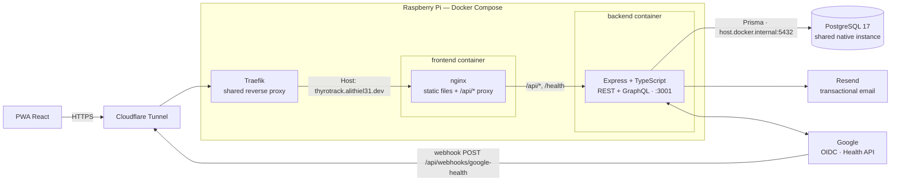
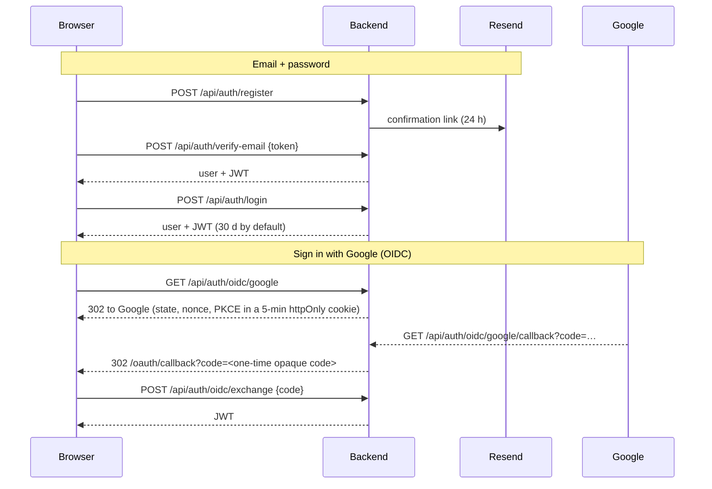
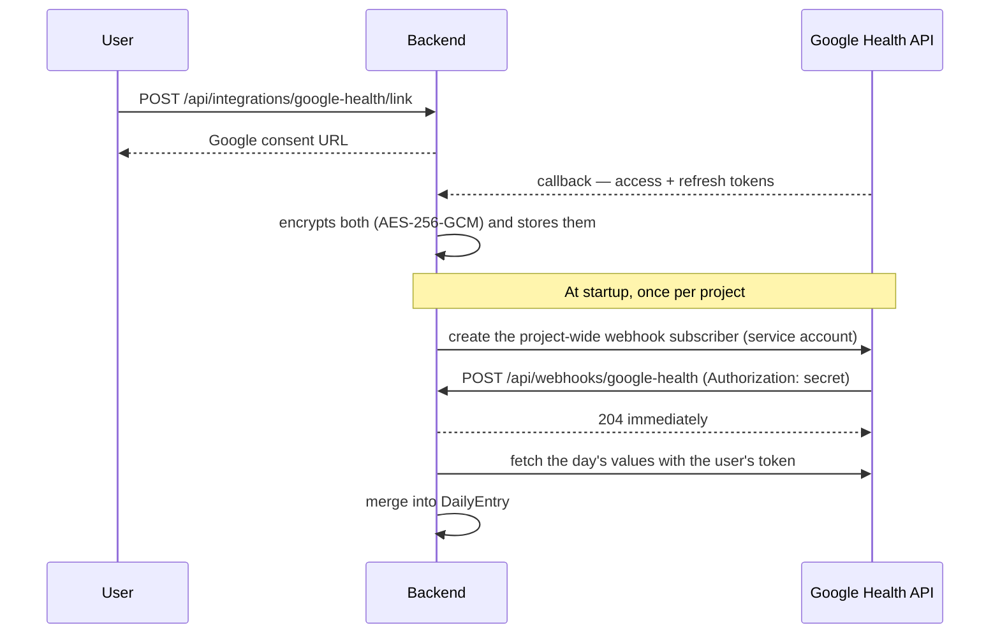
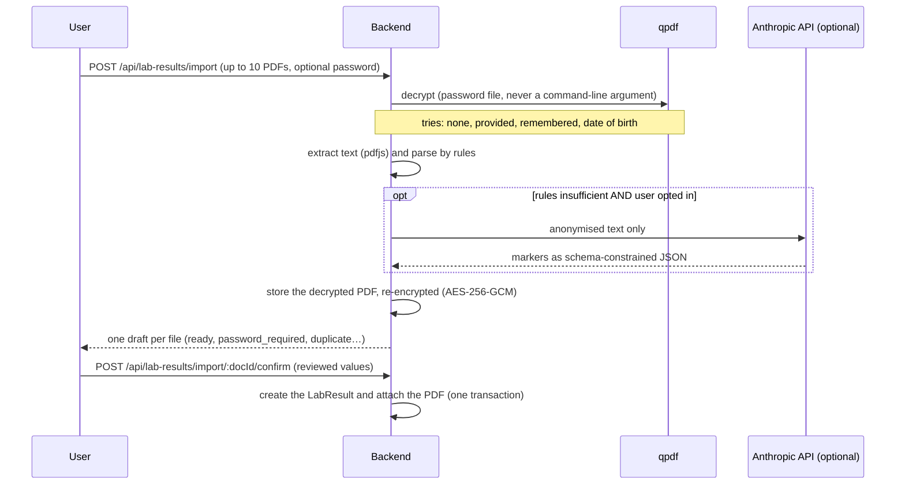

# Architecture

🇫🇷 [Version française](./architecture.fr.md)

[Back to the README](../README.md)

Overview of the system, from the browser to the database and the external services:



The browser only ever talks to nginx. nginx serves the React build and proxies `/api/*` (and
`/health`) to the Express backend over the internal Docker network — same-origin, so no CORS in
production. The backend is the only component that talks to PostgreSQL (through Prisma), to Resend
and to Google. Nothing is published on a host port: `frontend` joins the `traefik-net` network
(created by the shared Traefik, declared `external: true`) and carries the `traefik.*` labels that
route `thyrotrack.alithiel31.dev` to its port `80`.

PostgreSQL is **not** a service of `docker-compose.yml`. It is a native instance shared with other
projects on the host, reached from the backend container through `host.docker.internal` (the
`extra_hosts` entry maps it to the host gateway). The application role `thyrotrack_app` and the
`thyrotrack` database must therefore exist before the first start.

---

## Authentication



- **JWT** — `Authorization: Bearer <token>`, signed with `JWT_SECRET` (the server refuses to start in
  production with fewer than 32 characters). The frontend keeps it in `localStorage` (`thyro_token`)
  and an axios interceptor attaches it; any `401` clears it and redirects to `/login`.
- **Passwords** — bcrypt (cost 12), 8 characters minimum. An account created through Google has no
  local password until the user sets one (`User.password` is nullable). An account cannot log in
  before its email is verified.
- **OIDC** — handled with `openid-client` (authorization code + PKCE). The JWT never appears in a
  URL: the callback redirects with a short-lived opaque code that the SPA exchanges. Linking and
  unlinking Google from an existing account are `POST`/`DELETE /api/auth/oidc/google/link`,
  protected by the JWT.
- **Audit trail** — logins, links, conflicts and failures are written to `auth_events`
  (`AuthEventType`, with IP and user agent) and exposed to the user by `GET /api/profile/security/events`.
- **Roles** — `USER` or `ADMIN`. `requireAdmin` re-reads the role from the database on every
  request instead of trusting the token, so a revoked role takes effect immediately. Admins manage
  the editorial content (`/admin/articles`).

---

## Google Health synchronisation

A distinct feature from "Sign in with Google": it pre-fills **weight, heart rate and sleep hours**
in the daily log from a connected device (for example a Pixel Watch). It involves two separate
credentials:



- **User OAuth** (`GOOGLE_HEALTH_CLIENT_ID`/`SECRET`) — each user consents once. The tokens are
  stored **encrypted** in `google_health_connections` (`lib/crypto.ts`, AES-256-GCM with
  `TOKEN_ENCRYPTION_KEY`; a tampered value fails to decrypt rather than returning garbage).
- **Service account** (`GOOGLE_HEALTH_SERVICE_ACCOUNT_KEY`) — manages a **single project-wide
  subscriber**, created at backend startup if absent. Google then routes every consenting user's
  notifications to it.
- **Webhook** — the endpoint checks that the `Authorization` header equals
  `GOOGLE_HEALTH_WEBHOOK_SECRET`, answers the two-request validation handshake Google performs when
  creating the subscriber (200 with the secret, 401 without), answers `204` at once and processes
  the payload in the background. It must be reachable over **public HTTPS**; it cannot work on `localhost`.
- **Merge rule** — a value typed by the user is **never overwritten**. Each of the three fields has
  a `*Source` column (`MANUAL` or `GOOGLE_HEALTH`); a sync fills a field only if it is empty or was
  itself synced. Editing a field by hand sets its source back to `MANUAL`.
- **Known gap** — the shape of the JSON returned by the `dataTypes/{type}/dataPoints` endpoints could
  not be verified against real data; `fetchDailyMetrics` in `lib/googleHealth.ts` is a best guess
  (see the `[Unreleased] > To do` of the CHANGELOG).

---

## PDF lab report import

Blood-test PDFs dropped on the lab results page are read automatically and added to the log **after
the user reviews the extracted values**.



- **Drafts** — an imported PDF is a `LabDocument` with no `labResultId` until confirmed; unconfirmed
  drafts older than 24 h are purged at the next import. Re-uploading the same PDF reuses its draft;
  one already attached to the log is reported as a duplicate (`sha256` per user).
- **Extraction** — rules first (`lib/labExtract/rules.ts`: synonyms for the 17 markers of `LabResult`,
  unit conversion to the model's units, `<`/`>` values left for the user). The LLM
  (`lib/labExtract/llm.ts`) is a **fallback** used only when the user opted in
  (`UserProfile.aiExtractionConsentAt`); it receives text anonymised by `lib/labExtract/scrub.ts`
  (name, date of birth, contact details, social-security number, prescriber and address lines
  removed) — never the PDF. The anonymisation is best-effort, not a guarantee.
  With the profile setting **« AI reading on every import »** (`UserProfile.aiExtractionAlways`,
  off by default, requires the consent), the AI reads every report and the two readings are
  **compared**: the AI's value is proposed, and any disagreement (different value, value read by the
  rules only — typically a footnote — or different date) is returned in `draft.conflicts` and shown
  as « to check » in the review screen. « Retry with AI » on a draft does the same comparison once.
  Withdrawing the consent also switches this setting off.
- **Encryption at rest** — PDFs and remembered passwords use `PDF_ENCRYPTION_KEY` (distinct from
  `TOKEN_ENCRYPTION_KEY`), format `[key version][iv][tag][ciphertext]`. Remembered passwords
  (`pdf_passwords`) are **decryptable by the server**, by design (it must open the user's PDFs): this
  is not zero-knowledge. They can be revoked one by one or all at once from the profile; the stored
  PDF is a decrypted copy, so revoking a password does not lock the user out of their documents.
- **Not handled** — scanned PDFs (no text layer, no OCR), images, markers outside `LabResult`.
- **Pro access** — see [Pro access and payment](#pro-access-and-payment): the import is checked on the
  server *before* the PDFs are read (`402 PRO_REQUIRED` for a non-Pro account with no trial left,
  `429 MONTHLY_QUOTA_REACHED` at the monthly cap). `confirm`, `discard` and `download` stay open:
  documents already imported remain accessible after an access ends. A batch exceeding the balance is
  processed up to the balance; the remaining files get the `quota_exceeded` status. The result created
  on confirmation carries `source: PDF_IMPORT` (`MANUAL` for hand-typed entries).

---

## Pro access and payment

Manual entry and the export are free; **PDF lab report import** is reserved for Pro accounts.

- **Single source of the entitlement** — `User.proUntil` (+ `proSource`: `STRIPE`, `PROMO` or
  `GRANT`). `lib/entitlements.ts#isPro`: Pro while `proUntil` is in the future, or role `ADMIN`. The
  rest of the code does not care where the access came from. `/api/auth/me` only exposes the
  `entitlements` summary.
- **Import balance** — outside Pro: a trial of `FREE_IMPORT_LIMIT` (3) imports **for life**
  (`User.freeImportsUsed`); Pro: `PRO_MONTHLY_IMPORT_LIMIT` (25) per UTC month (`import_usages`, one
  row per user and month). Only an extraction actually performed consumes an import (not a duplicate,
  a missing password or an invalid PDF).
- **Stripe** — `POST /api/billing/checkout` creates a Checkout session (`client_reference_id` and
  `subscription_data.metadata.userId` = the account id), `POST /api/billing/portal` opens the customer
  portal. The webhook `POST /api/webhooks/stripe` is mounted **before** `express.json()` (the raw body
  is needed to verify the signature). On every subscription event it **re-reads the subscription from
  Stripe** (delivery order is not guaranteed and an event can be replayed) and writes `proUntil` = end
  of the paid period (statuses `active`, `trialing`, `past_due`) or `now` (subscription ended). The
  account is found by `stripeCustomerId`, otherwise by `metadata.userId`. A processing failure answers
  `500`: Stripe retries.
- **Promo codes** — `PromoCode` (duration, max redemptions, expiry, active) and `PromoRedemption` (an
  account can use a code only once). `POST /api/billing/redeem` extends `proUntil` by the code's
  duration; the counter is incremented conditionally (the last slot cannot be taken twice). An unknown,
  deactivated, expired or exhausted code returns the same error. Refused while a Stripe subscription is
  active. Management: `/api/admin/promo-codes` (ADMIN).

---

## Backend layers

A request goes through the same stack in `src/index.ts`:

`helmet` → i18next language detection (`Accept-Language` or `?lng=`) → CORS (allow-list from
`FRONTEND_URL`, credentials on) → global rate limit → `express.json` → `cookie-parser` →
`express-xss-sanitizer` → router → `errorHandler`.

- **Routers** (`routers/*.router.ts`) declare routes and wrap controllers in `asyncHandler`; nearly
  all of them sit behind `authenticate`.
- **Controllers** (`controllers/*.controller.ts`) hold the business logic and validate input with
  **Zod**, with error messages translated through i18next (`locales/{fr,en}/translation.json`).
- **Persistence** — Prisma 5 on PostgreSQL. Schema changes go through migrations in
  `prisma/migrations/`, replayed at container start (`prisma migrate deploy`).
- **GraphQL** — `POST /graphql` (Apollo Server 5) is a deliberate technical demo, **additive** to the
  REST API: no REST route was removed and the frontend uses REST only. It reproduces the JWT check,
  uses DataLoaders to avoid the N+1 trap, and is described in [`backend/docs/graphql.md`](../backend/docs/graphql.md).
- **Rate limiting** — `express-rate-limit`: 100 requests / 15 min / IP overall, and 20 / 15 min on
  `/api/auth` (failed attempts only — successful requests are not counted).
- **Health check** — `GET /health` → `{status: "ok", timestamp}`, used by the Docker healthcheck and
  exposed by nginx at `/health`.

---

## Frontend

React 18 + Vite, installable as a PWA (`vite-plugin-pwa`, `registerType: 'autoUpdate'`). The service
worker precaches the app shell, caches the Google fonts at runtime (cache-first) and **never serves
`/api` from cache**: health data must always be fresh.

- **State** — Zustand for the session (`lib/store.ts`), TanStack Query for server data, React Router 6.
- **API** — `lib/api.ts` is the single typed axios client.
- **Routes** — public: `/login`, `/register`, `/verify-email`, `/forgot-password`, `/reset-password`,
  `/oauth/callback`. Behind `RequireAuth`, inside `AppShell`: `/dashboard`, `/log[/:date]`,
  `/lab-results`, `/medications`, `/appointments`, `/learn[/:slug]`, `/admin/articles`, `/profile`.
  The printable `/report` is authenticated but rendered outside the shell (no sidebar on paper).
- **i18n** — i18next with `fr`/`en` dictionaries (`src/locales/`).
- **Style** — CSS Modules, dark palette with a purple/teal/pink accent, DM Serif Display + DM Sans,
  bottom navigation on mobile.

---

## Data model

```
User ─┬─ UserProfile            diagnosis, thyroid status, target ranges
      ├─ DailyEntry[]           daily log: energy/mood/anxiety/brain fog, 11 symptoms, sleep, vitals,
      │    └─ SymptomLog[]      custom symptoms (from SymptomLibrary)
      ├─ LabResult[]            TSH, FT4, FT3, antibodies, deficiencies
      │    └─ LabDocument[]     encrypted PDF of the report (bytea), draft until confirmed
      ├─ PdfPassword[]          remembered PDF passwords (encrypted, revocable)
      ├─ ImportUsage[]          PDF imports of the month (Pro accounts)
      ├─ PromoRedemption[]      promo codes used
      ├─ Medication[]           treatments (dosage, frequency, intake slots)
      │    └─ MedicationIntake[]  recorded doses
      ├─ Appointment[]          medical appointments (type, status)
      ├─ OAuthAccount[]         federated identities (provider + sub)
      ├─ AuthEvent[]            sign-in / link audit trail
      ├─ GoogleHealthConnection encrypted tokens, lastSyncedAt, healthUserId
      └─ NotificationSetting

PromoCode                        promo code (duration, redemption limit) — free Pro access
Article                          editorial content: ARTICLE ("Learn") or TIP (dashboard card)
```

`DailyEntry` is unique per `(userId, date)`; `POST /api/entries` is an upsert on the date.
Deleting a `User` cascades to their data.

---

## Structure

```
ThyFollow/
├── docker-compose.yml          # backend + frontend; PostgreSQL and Traefik are external
├── .env.example                # variables read by docker-compose.yml (DB_PASSWORD, PDF_ENCRYPTION_KEY, ANTHROPIC_API_KEY)
├── deploy.sh                   # production deploy: secrets injected from Infisical, then docker compose up
├── .infisical-identity.env.example  # template of the (git-ignored) Infisical credentials used by deploy.sh
├── .nvmrc                      # Node 24
├── backend/
│   ├── Dockerfile              # multi-stage, node:24-alpine, non-root, dumb-init, migrate deploy at start
│   ├── prisma/                 # schema.prisma, migrations/, seed.ts
│   ├── docs/graphql.md
│   └── src/
│       ├── index.ts            # Express app and middleware chain
│       ├── config.ts           # environment variables, production guards
│       ├── routers/            # route declarations
│       ├── controllers/        # business logic + Zod validation
│       ├── middleware/         # auth, admin, asyncHandler, errorHandler
│       ├── graphql/            # Apollo schema, resolvers, DataLoaders, context
│       ├── lib/                # prisma, crypto, oidc, googleHealth*, resend, i18n, logger
│       └── locales/            # fr / en API messages
├── frontend/
│   ├── Dockerfile              # Vite build → nginx
│   ├── nginx.conf              # security headers, /api and /health proxy, SPA fallback
│   ├── vite.config.ts          # PWA, dev proxy /api → :3001
│   └── src/
│       ├── pages/              # one file per screen (+ tests)
│       ├── components/         # AppShell
│       ├── lib/                # api, store, i18n, theme, calendar, utils
│       ├── locales/            # fr / en UI strings
│       └── types/index.ts
└── docs/                       # this documentation
```
